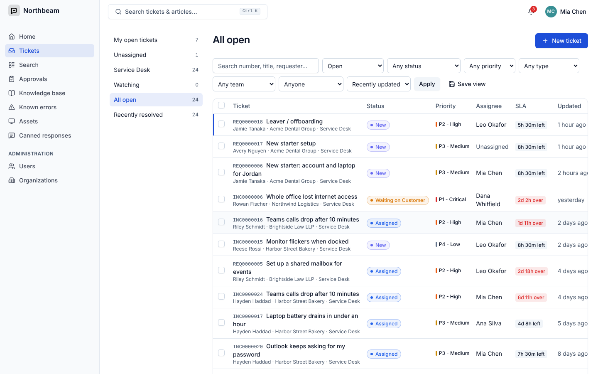
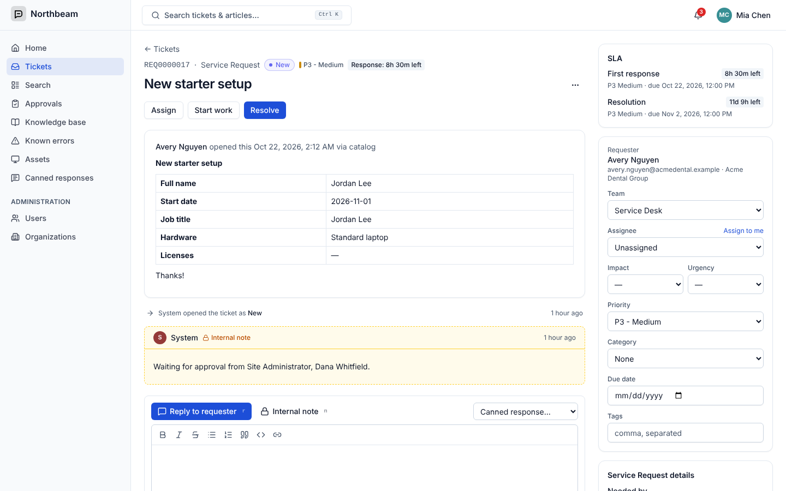
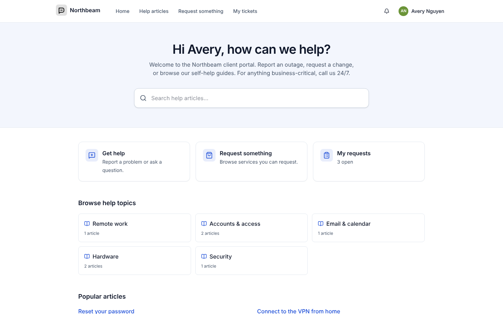
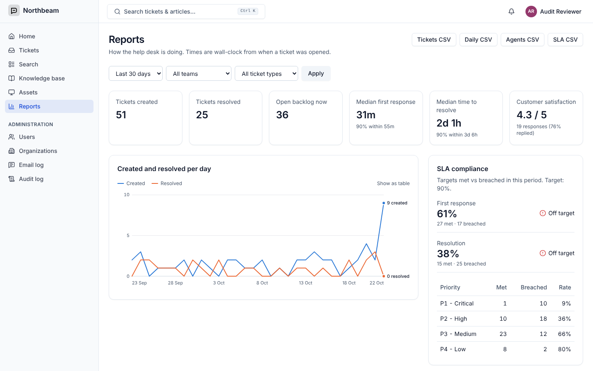
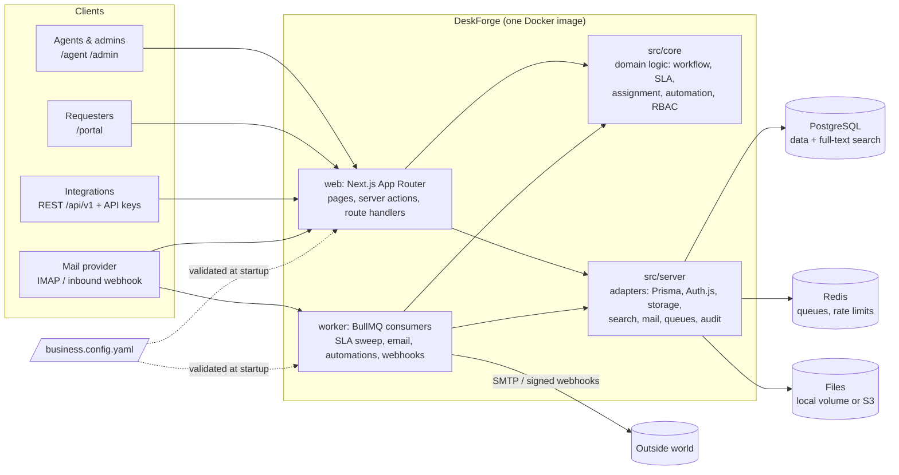

# DeskForge

A self-hostable, configuration-driven IT service management and help desk
platform: ticketing with configurable workflows, SLAs, email-to-ticket, a branded
customer portal, knowledge base, service catalog, automations, assets and
reporting.

DeskForge is a **template**. Each business gets its own deployment made from two
files, with no code changes:

- **`.env`** holds secrets and infrastructure (database, SMTP, SSO client secrets).
- **`business.config.yaml`** holds everything else: name, logo, colors, business
  hours, ticket types, custom fields, workflows, priorities, SLAs, teams,
  routing and feature flags.

| Agent console | Ticket workspace |
| --- | --- |
|  |  |
| **Customer portal** | **Reports** |
|  |  |

_Screenshots use the seeded `msp-it-support` demo._

## Features

- **Ticketing**: ticket types with their own prefixes (`INC0001042`), custom fields, and workflows with role-restricted transitions. Assignment can be round-robin, load-balanced or manual. Also watchers, CC, @mentions, internal notes, attachments, merge, parent/child and related links, bulk edit, saved views and full-text search.
- **SLAs**: first-response and resolution targets per priority and type, business hours and holidays, pause states, warnings, breach escalation (notify, reassign, raise priority) and audited overrides.
- **Email**: outbound notifications with reply threading. Inbound by IMAP or provider webhook, with quoted-text stripping and loop and auto-reply protection.
- **Portal**: branded help center, knowledge base with suggestions as you type, service catalog with approvals, ticket tracking, CSAT surveys, optional public sign-up.
- **Automation & integrations**: trigger, condition and action rules (including scheduled ones), canned responses and macros, signed webhooks with retries, a REST API with scoped API keys, and an OpenAPI spec at `/api-docs`.
- **ITSM**: problems and known errors, changes with risk and CAB approval, an asset inventory (CMDB) with CSV import and export, and Kanban boards.
- **Reporting**: volumes, response and resolution times, SLA compliance, backlog, agent workload and CSAT, with CSV exports.
- **Security**: roles editable in the UI, granular permissions checked on every API route, audit log, local accounts with password policy, lockout and TOTP 2FA (required per role), OIDC single sign-on (Microsoft Entra ID, Google), CSRF and origin checks, rate limits, CSP and security headers, and upload type and size limits.

## Quick start (Docker)

```bash
git clone <this repo> deskforge && cd deskforge
cp .env.example .env                            # set AUTH_SECRET, POSTGRES_PASSWORD, SEED_ADMIN_*
cp examples/internal-it.yaml business.config.yaml
docker compose up -d
open http://localhost:3000
```

Set `SEED_DEMO_DATA=true` in `.env` before the first start to load a realistic
demo (organizations, agents, requesters, tickets in every state, KB articles).
Demo accounts use the password `DeskForge-Demo-2026!` unless you set
`SEED_DEMO_PASSWORD`.

To spin up a **new business** in its own folder, with generated secrets:

```bash
scripts/new-business.sh acme msp-it-support     # → deployments/acme/
cd deployments/acme && docker compose up -d
```

See [docs/DEPLOYING-A-NEW-BUSINESS.md](docs/DEPLOYING-A-NEW-BUSINESS.md) for DNS,
reverse proxy (Caddy / Nginx), email and SSO (Microsoft Entra ID, Google) setup.

## Example configurations

| File | Scenario |
| --- | --- |
| [`examples/msp-it-support.yaml`](examples/msp-it-support.yaml) | Managed IT provider serving several client companies. ITIL incidents, requests, problems and changes with CAB approval. 24/7 P1 SLA, Entra ID sign-in. |
| [`examples/internal-it.yaml`](examples/internal-it.yaml) | Volunteer IT desk for a club or small org. Google sign-in, catalog with approvals, assets, and a Kanban board for internal projects. |
| [`examples/ecommerce-support.yaml`](examples/ecommerce-support.yaml) | Customer care for an online store. Order and return forms, public sign-up, CSAT surveys, no ITIL change management. |

Every option is documented in [docs/CONFIG-REFERENCE.md](docs/CONFIG-REFERENCE.md).
Validate a config without starting anything:

```bash
npm run config:check -- path/to/business.config.yaml
```

## Architecture



- **`src/core`** contains pure TypeScript domain logic (config schema, workflow
  engine, SLA calculator, assignment, automation rules, permissions). It never
  imports Next.js and is unit-tested in isolation.
- **`src/server`** contains infrastructure: database, auth, the API wrapper
  (Zod validation, permission check, CSRF, rate limit, audit), queues, mail and
  storage.
- **`src/app`** contains Next.js routes. Route handlers stay thin and call
  services.
- **`src/worker`** is the BullMQ worker process, run from the same image.

## Development

Requirements: Node 22+, PostgreSQL 16, Redis 7 (or `docker compose up -d postgres redis`).

```bash
npm install
cp .env.example .env              # set DATABASE_URL, REDIS_URL, AUTH_SECRET
cp examples/msp-it-support.yaml business.config.yaml
npx prisma migrate deploy && npm run db:seed
npm run dev                       # web on :3000
npm run worker:dev                # background worker
```

| Command | What it does |
| --- | --- |
| `npm test` | Unit + integration tests (Vitest; integration tests use `<db>_test`) |
| `npm run test:e2e` | Playwright end-to-end tests (see below) |
| `npm run typecheck` | TypeScript |
| `npm run config:check` | Validate a business config |
| `npm run config:sync` | Push config changes (types, SLAs, categories) into the database |
| `npm run db:migrate` | Create a migration after editing `prisma/schema.prisma` |

### End-to-end tests

`npm run test:e2e` starts its own environment on port 3100: a fresh
`deskforge_e2e` database seeded from `examples/msp-it-support.yaml`, Redis
database 1, the background worker and a dev server with its own build folder
(`.next-e2e`). Your normal dev server and data are left alone. It needs local
PostgreSQL and Redis, with a role that can create databases. Override the
connection with `E2E_DATABASE_URL` / `E2E_REDIS_URL`, and point
`PW_CHROMIUM` at a browser if Playwright's own isn't installed.

The suite covers sign-in (wrong password, 2FA enrolment and code entry), raising
a ticket in the portal, an agent reply reaching the requester, an emailed reply
threading back onto its ticket, an SLA breach being detected and escalated, and
automations running on new tickets.

## Project layout

```
examples/            three ready-made business configs
branding/            default logo/favicon (each deployment mounts its own)
deploy/              Caddyfile and Nginx example
docs/                deployment, config reference, upgrading
prisma/              schema, migrations, seed
scripts/             new-business.sh, backup/restore, entrypoint, config tools
src/app/             Next.js routes: /agent, /admin, /portal, /api/v1, …
src/core/            domain logic (no framework imports)
src/server/          infrastructure adapters + services
src/worker/          BullMQ worker
src/components/      UI (Tailwind + shadcn-style components)
tests/               unit, integration (Vitest) and e2e (Playwright)
```

## Documentation

- [Deploying a new business](docs/DEPLOYING-A-NEW-BUSINESS.md)
- [Configuration reference](docs/CONFIG-REFERENCE.md)
- [Upgrading](docs/UPGRADING.md)
- [Design decisions](DECISIONS.md)

## License

MIT
